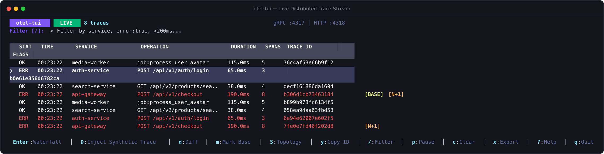
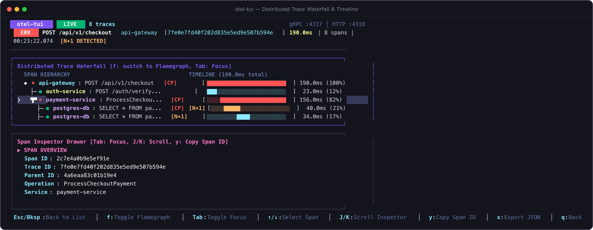
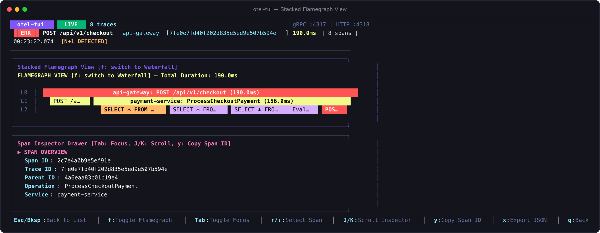
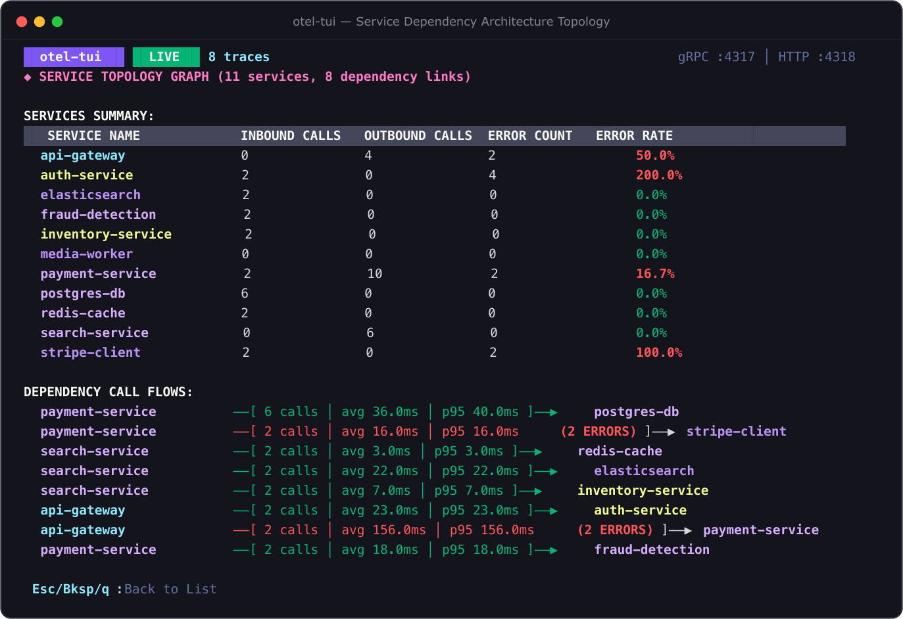

# otel-tui — Zero-Setup Terminal OpenTelemetry Viewer

> **Distributed tracing shouldn't require spinning up a cloud data center on your laptop.**

`otel-tui` is a single-binary, zero-setup in-memory OpenTelemetry collector and interactive terminal viewer. It listens on standard OTLP HTTP (`:4318`) and gRPC (`:4317`) ports, captures traces and logs directly in memory, and gives you instant, keyboard-driven visibility into your distributed services—right inside your terminal pane.

No Docker containers, no Jaeger, Tempo, or Grafana setup required. Just launch `otel-tui`, point your application's OpenTelemetry SDK to `localhost:4318`, and debug your traces immediately.

📖 **Documentation**: [https://smford.github.io/otel-tui/](https://smford.github.io/otel-tui/)



---

## The Problems otel-tui Solves

Distributed tracing is one of the most powerful observability tools in modern engineering, but local debugging is notoriously frustrating. Here is why `otel-tui` was built:

### 1. The Heavyweight Observability Stack Trap
* **The Problem**: To inspect OpenTelemetry traces locally, developers are usually told to spin up Docker Compose stacks containing Jaeger, Grafana Tempo, Prometheus, and an OpenTelemetry Collector daemon. These containers easily chew up 3–6 GB of RAM, spin up cooling fans, require complex YAML routing configs, and take minutes to start.
* **The Solution**: `otel-tui` is a single static binary compiled with zero CGO dependencies. It requires **no Docker**, **no daemon**, and **no configuration**. It launches in **under 10 milliseconds** and uses **less than 20 MB of RAM**. When you're done, quit with `q` and your machine stays clean.

### 2. The "Did My Spans Even Send?" Black Hole
* **The Problem**: You just instrumented a new endpoint with the OpenTelemetry SDK. You trigger a test request, but nothing shows up in your remote APM dashboard. Is there an export delay? Was the endpoint URL wrong? Did the exporter silently fail on an unhandled error? You're left guessing in the dark.
* **The Solution**: Live, instantaneous local verification. Start `otel-tui`, fire your request, and the trace appears on your terminal screen within microseconds. If default ports `4317` or `4318` are already taken by another tool, `otel-tui` automatically binds to the next free port and tells you immediately.

### 3. Context Switching & Browser Tab Fatigue
* **The Problem**: You write code in your terminal or IDE, but to debug latency you have to switch over to a browser window, log into a heavy web UI, navigate through multiple dropdowns and search filters, copy-paste 32-character trace IDs, and squint at cluttered web charts.
* **The Solution**: Keep your flow state. Split a pane in your terminal: your code on the left, `otel-tui` on the right. Navigate with familiar Vim keybindings (`j`/`k`), search with `/`, switch between Waterfall and Flamegraph with `f`, and copy IDs directly to your system clipboard with `y`.

### 4. Hunting Down Latency Regressions
* **The Problem**: You make a change to an endpoint, and suddenly response time jumps from 120ms to 650ms. Finding *which* child span slowed down, *which* downstream call was added, or *why* a cache was bypassed typically requires opening two separate browser tabs and manually comparing dozens of timestamps row by row.
* **The Solution**: Built-in **Trace Diffing** (`m` to mark a baseline trace, `d` to compare). `otel-tui` calculates the exact duration delta (`+530ms / +441%`), marks newly added spans (`+`), missing spans (`-`), and highlights status changes from `OK` to `ERROR`.

### 5. Silent ORM Loops (The N+1 Query Nightmare)
* **The Problem**: Object-Relational Mappers (ORMs) like Hibernate, Prisma, or ActiveRecord make it dangerously easy to run queries inside a loop. Instead of one batch query, your app executes 50 sequential database round trips. The application doesn't crash or throw errors, but it quietly crushes database performance.
* **The Solution**: **Automated In-Memory N+1 Detection**. `otel-tui` continuously analyzes database spans, normalizes SQL literals (e.g. `WHERE id = ?`), and immediately slaps an amber `<N+1>` warning badge on offending spans and traces so you catch query loops before code ever reaches code review.

### 6. Untangling Microservice Spaghetti
* **The Problem**: In a distributed architecture, it's hard to keep track of which services communicate with each other, what their invocation volumes are, and where cascading failures originate.
* **The Solution**: Real-Time **Service Topology Graph** (`S`). `otel-tui` automatically discovers call flows between services from incoming spans, generating a real-time dependency map with call counts, average latency, p95 latency, and error rates per service link.

### 7. Testing Tooling Without Running Live Backends
* **The Problem**: You want to test alerting rules, demo tracing UI features, or verify collector pipelines, but you don't have a cluster of live microservices running locally.
* **The Solution**: Built-In **Synthetic Traffic Generator** (`--demo` or press `D`). Generates realistic multi-tier e-commerce transactions, database query loops, cache misses, and timeouts on demand.

### 8. Dual-Visibility Without Breaking Team Pipelines
* **The Problem**: Your staging or development environment already forwards traces to a centralized cloud APM (Datadog, Honeycomb, Jaeger, Tempo). Pointing your app to a local tool means your teammates lose trace visibility in the shared dashboard.
* **The Solution**: **Transparent Relay Mode** (`--forward-to <url>`). `otel-tui` acts as a pass-through proxy: it inspects and renders spans locally in your terminal while simultaneously forwarding untouched OTLP payloads upstream.

---

## Features

- **Zero-Setup & Zero-CGO**: Single portable static binary compiled with `CGO_ENABLED=0`.
- **Automatic Port Fallback**: Automatically binds to alternate ports (e.g. `:14318`) if default ports are already occupied.
- **OTLP Relay / Proxy Forwarding (`--forward-to <url>`)**: Asynchronously tee and forward incoming traces/logs to an upstream collector (e.g. Datadog, Jaeger, Tempo, Honeycomb) while debugging locally.
- **Dual OTLP Ingestion**:
  - **OTLP/HTTP** (`:4318`): `POST /v1/traces` and `POST /v1/logs` supporting both `application/x-protobuf` and `application/json` payloads, with transparent gzip decompression and CORS support.
  - **OTLP/gRPC** (`:4317`): Native high-performance gRPC export endpoint.
- **Interactive Terminal UI** (built with Bubbletea & Lipgloss):
  - **Live Trace List View**: Real-time overview of incoming traces with service names, root operations, durations, span counts, and status badges (`OK` / `ERR`).
  - **Trace Comparison & Diffing (`m` to mark, `d` to diff)**: Compare two traces side-by-side to instantly pinpoint latency regressions, missing/added spans, or status changes.
  - **N+1 Database Query Detection (`[N+1]`)**: Automatically flags traces executing repetitive parameterized database queries and highlights the offending spans.
  - **Service Dependency Architecture Map (`S` key)**: Inferred live directed topology graph showing inter-service call volumes, avg/p95 latencies, and error counts.
  - **Distributed Trace Waterfall & Stacked Flamegraph (`f` key)**: Toggle between hierarchical indented span tree and proportional stacked flamegraph views (`████░░░░`).
  - **Critical-Path Highlighting**: Automatically identifies and highlights the bottleneck execution path (`[CP]`) and error spans in red.
  - **Span Inspector Drawer**: Full inspection of span attributes, resource attributes, exception events with stack traces, and correlated OTLP logs.
  - **Clipboard Copy (`y` / `Y`)**: Copy selected `TraceID`, `SpanID`, or full trace JSON to clipboard via OSC 52 / native clipboard tools.
  - **Live Search & Filtering**: Instant querying by service name, error status (`error:true`), duration (`>200ms`, `<50ms`), or free-text keywords.
  - **Ring Buffer Memory Bounds**: Thread-safe bounded buffer (default 1,000 traces) guarantees flat memory usage under load.
  - **Trace Export & Offline Replay**: Save traces to JSON (`x`) and replay them offline (`--replay <file.json>`).
- **Headless CLI Dump Mode**: Stream colorized trace summaries or structured JSON lines (`--headless --json`) to stdout for piping or CI integration.
- **Built-in Demo Generator**: Simulate realistic multi-service traces (`api-gateway` -> `auth-service` -> `payment-service` -> `postgres-db`, `stripe-client`) with slow queries, N+1 query loops, and exceptions via `otel-tui demo`.

---

## Interactive Views Preview

### Distributed Trace Waterfall
Hierarchical span trees with microsecond timing alignment, critical path identification, and error highlights.


### Stacked Flamegraph View
Press `f` to switch from waterfall to proportional stacked depth layers.


### Service Dependency Architecture Topology
Press `S` to inspect real-time inter-service call volumes, avg/p95 latencies, and error rates.


### Comparative Trace Diffing
Press `m` to mark a baseline and `d` to pinpoint latency regressions between runs.


### Span Inspector Drawer
Press `Enter` or `i` to inspect attributes, exception stack traces, and correlated logs.


---

## Installation & Quick Start

### Build from Source

Requirements: Go 1.23+

```bash
git clone https://github.com/smford/otel-tui.git
cd otel-tui
make build
```

This compiles a standalone executable at `bin/otel-tui`.

### Quick Start

#### Option A: Zero Emitter Needed (Built-in Continuous Generator)
If you don't have an OpenTelemetry emitter yet, run with `--demo` to automatically feed realistic continuous synthetic telemetry:
```bash
./bin/otel-tui --demo
```
*(Or press `D` anytime inside the interactive TUI to inject a new synthetic trace on demand!)*

#### Option B: Standalone Continuous Emitter
Run the collector in one pane and stream realistic multi-scenario traffic from another:
```bash
# Pane 1: Collector & TUI
./bin/otel-tui

# Pane 2: Stream realistic synthetic traces continuously
./bin/otel-tui demo --stream --interval 1s
```

#### Option C: Connect Your Application
Start `otel-tui` and point your application's OpenTelemetry SDK to `localhost:4318`:
```bash
./bin/otel-tui
```
```bash
# In your application's environment:
export OTEL_EXPORTER_OTLP_ENDPOINT="http://localhost:4318"
```

---

## Keyboard Controls Cheat Sheet

| Key | Action |
|---|---|
| `↑` / `k`, `↓` / `j` | Move selection up / down |
| `Enter` | Drill down into Trace Waterfall / Flamegraph |
| `Esc` / `Backspace` | Return to Trace List view |
| `D` | **Inject synthetic trace on-demand** |
| `f` | Toggle between Waterfall and stacked Flamegraph |
| `d` | **Diff selected trace** against marked baseline or previous trace |
| `m` | **Mark / unmark baseline trace** (`[BASE]`) |
| `S` | Open **Service Dependency Architecture Topology** map |
| `Tab` | Switch focus between Waterfall and Span Inspector drawer |
| `J` / `K` | Scroll Span Inspector drawer |
| `y` | Copy selected `TraceID` or `SpanID` to clipboard |
| `Y` | Copy full trace JSON to clipboard |
| `/` | Live filter traces (`service:api`, `error:true`, `>200ms`) |
| `p` | Pause / resume live ingestion stream |
| `c` | Clear in-memory buffer |
| `x` | Export trace to `trace_<id>.json` |
| `?` | Toggle in-app help modal |
| `q` / `Ctrl+C` | Quit |

---

## License

MIT License. See [LICENSE](LICENSE) for details.
