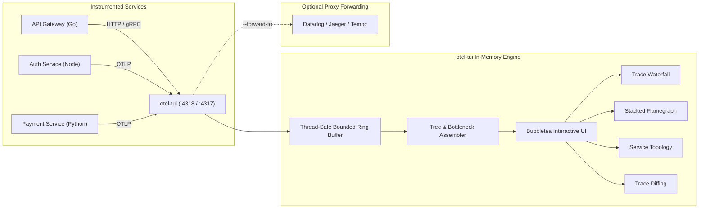

# otel-tui

> **Zero-Setup, Zero-CGO Terminal OpenTelemetry Collector & Interactive Viewer**

`otel-tui` is a single-binary, in-memory OpenTelemetry collector and terminal UI. It receives distributed traces and correlated logs over standard OTLP HTTP (`:4318`) and gRPC (`:4317`) protocols directly in memory, rendering live distributed trace waterfalls, critical-path flamegraphs, service dependency graphs, trace diffing, and error diagnostics right in your terminal pane.

---

## Why otel-tui?

Debugging OpenTelemetry trace propagation locally usually requires spinning up Docker containers for Jaeger, Tempo, or Grafana. Developers want to run a single command (`otel-tui`) in a terminal pane, point their app to `localhost:4318`, and immediately inspect traces, span attributes, and latency bottlenecks.

> [!TIP]
> **No Emitter? No Problem!**
> `otel-tui` includes a built-in synthetic traffic generator. Run `otel-tui --demo` to start with continuous realistic background traffic, or press `D` inside the TUI to inject traces on demand.

---

## Core Highlights

- **Zero-Setup & Zero-CGO**: Single portable static binary compiled with `CGO_ENABLED=0`.
- **Automatic Port Fallback**: Automatically binds to alternate ports (e.g. `:14318`) if default ports are already occupied.
- **Dual OTLP Ingestion**: Ingests `application/x-protobuf` and `application/json` over HTTP (`:4318`) with transparent gzip decompression, and gRPC (`:4317`).
- **Interactive Views**:
  - [Trace Waterfall](views/waterfall.md): Hierarchical tree with indented guide lines and proportional ASCII/Unicode timeline bars (`████░░░░`).
  - [Stacked Flamegraph](views/flamegraph.md): Toggle with `f` to view proportional stacked layers by depth.
  - [Service Topology Graph](views/topology.md): View inter-service call volumes, avg/p95 latencies, and error rates (`S` key).
  - [Trace Diffing](views/diff.md): Mark a baseline trace with `m` and diff with `d` to detect regressions.
  - [N+1 Query Detection](views/n-plus-one.md): Automatically flags repetitive parameterized SQL queries.
  - [Span Inspector](views/inspector.md): Inspect attributes, resource metadata, exception events with stack traces, and correlated logs.
- **Built-in Synthetic Traffic**: Multi-service simulation with slow queries, timeouts, and exceptions.
- **Headless Mode**: Stream formatted summaries or structured JSON lines (`--headless --json`) to stdout for CI pipelines.

---

## Quick Navigation

* Ready to start? Head to [Quick Start](getting-started.md).
* Want to hook up your services? Check [Connecting Your Application](ingestion/connecting-apps.md).
* Exploring views? Check the [Trace Waterfall](views/waterfall.md) and [Stacked Flamegraph](views/flamegraph.md).
