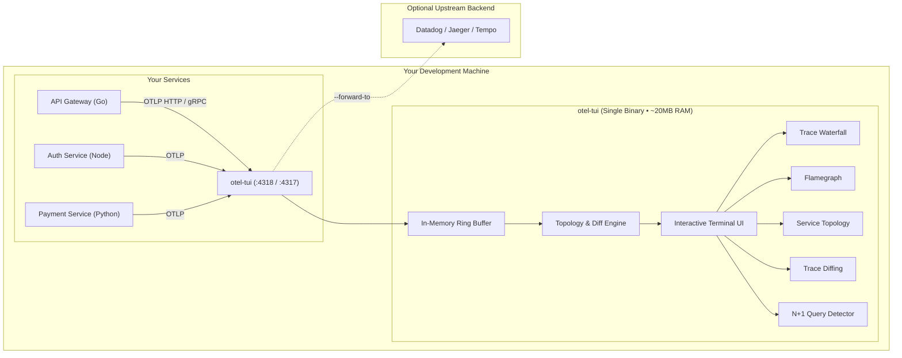

# otel-tui

> **Distributed tracing shouldn't require spinning up a cloud data center on your laptop.**

`otel-tui` is a single-binary, zero-setup in-memory OpenTelemetry collector and interactive terminal viewer. It listens on standard OTLP HTTP (`:4318`) and gRPC (`:4317`) ports, captures traces and logs directly in memory, and gives you instant, keyboard-driven visibility into your distributed services—right inside your terminal pane.

---

## The Problems otel-tui Solves

Distributed tracing is one of the most powerful observability tools in modern engineering, but the local development experience is notoriously painful. Here is why `otel-tui` was built:

### 1. The Heavyweight Observability Stack Trap
* **The Problem**: To inspect OpenTelemetry traces locally, developers are usually told to spin up Docker Compose stacks containing Jaeger, Grafana Tempo, Prometheus, and an OpenTelemetry Collector daemon. These containers easily chew up 3–6 GB of RAM, spin up cooling fans, require complex YAML routing configs, and take minutes to start.
* **The Solution**: `otel-tui` is a single static binary compiled with zero CGO dependencies. It requires **no Docker**, **no daemon**, and **no configuration**. It launches in **under 10 milliseconds** and uses **less than 20 MB of RAM**. When you're done, quit with <kbd>q</kbd> and your machine stays clean.

### 2. The "Did My Spans Even Send?" Black Hole
* **The Problem**: You just instrumented a new endpoint with the OpenTelemetry SDK. You trigger a test request, but nothing shows up in your remote APM dashboard. Is there an export delay? Was the endpoint URL wrong? Did the exporter silently fail on an unhandled error? You're left guessing in the dark.
* **The Solution**: Live, instantaneous local verification. Start `otel-tui`, fire your request, and the trace appears on your terminal screen within microseconds. If default ports `4317` or `4318` are already taken by another tool, `otel-tui` automatically binds to the next free port and tells you immediately.

### 3. Context Switching & Browser Tab Fatigue
* **The Problem**: You write code in your terminal or IDE, but to debug latency you have to switch over to a browser window, log into a heavy web UI, navigate through multiple dropdowns and search filters, copy-paste 32-character trace IDs, and squint at cluttered web charts.
* **The Solution**: Keep your flow state. Split a pane in your terminal: your code on the left, `otel-tui` on the right. Navigate with familiar Vim keybindings (<kbd>j</kbd>/<kbd>k</kbd>), search with <kbd>/</kbd>, switch between Waterfall and Flamegraph with <kbd>f</kbd>, and copy IDs directly to your system clipboard with <kbd>y</kbd>.

### 4. Hunting Down Latency Regressions
* **The Problem**: You make a change to an endpoint, and suddenly response time jumps from 120ms to 650ms. Finding *which* child span slowed down, *which* downstream call was added, or *why* a cache was bypassed typically requires opening two separate browser tabs and manually comparing dozens of timestamps row by row.
* **The Solution**: Built-in **Trace Diffing** (<kbd>m</kbd> to mark a baseline trace, <kbd>d</kbd> to compare). `otel-tui` calculates the exact duration delta (`+530ms / +441%`), marks newly added spans (`+`), missing spans (`-`), and highlights status changes from `OK` to `ERROR`.

### 5. Silent ORM Loops (The N+1 Query Nightmare)
* **The Problem**: Object-Relational Mappers (ORMs) like Hibernate, Prisma, or ActiveRecord make it dangerously easy to run queries inside a loop. Instead of one batch query, your app executes 50 sequential database round trips. The application doesn't crash or throw errors, but it quietly crushes database performance.
* **The Solution**: **Automated In-Memory N+1 Detection**. `otel-tui` continuously analyzes database spans, normalizes SQL literals (e.g. `WHERE id = ?`), and immediately slaps an amber `<N+1>` warning badge on offending spans and traces so you catch query loops before code ever reaches code review.

### 6. Untangling Microservice Spaghetti
* **The Problem**: In a distributed architecture, it's hard to keep track of which services communicate with each other, what their invocation volumes are, and where cascading failures originate.
* **The Solution**: Real-Time **Service Topology Graph** (<kbd>S</kbd>). `otel-tui` automatically discovers call flows between services from incoming spans, generating a real-time dependency map with call counts, average latency, p95 latency, and error rates per service link.

### 7. Testing Tooling Without Running Live Backends
* **The Problem**: You want to test alerting rules, demo tracing UI features, or verify collector pipelines, but you don't have a cluster of live microservices running locally.
* **The Solution**: Built-In **Synthetic Traffic Generator** (`--demo` or press <kbd>D</kbd>). Generates realistic multi-tier e-commerce transactions, database query loops, cache misses, and timeouts on demand.

### 8. Dual-Visibility Without Breaking Team Pipelines
* **The Problem**: Your staging or development environment already forwards traces to a centralized cloud APM (Datadog, Honeycomb, Jaeger, Tempo). Pointing your app to a local tool means your teammates lose trace visibility in the shared dashboard.
* **The Solution**: **Transparent Relay Mode** (`--forward-to <url>`). `otel-tui` acts as a pass-through proxy: it inspects and renders spans locally in your terminal while simultaneously forwarding untouched OTLP payloads upstream.

---

## Feature Tour

| Feature | Shortcut / Flag | Why You'll Love It |
|:---|:---:|:---|
| **Trace Waterfall** | <kbd>Enter</kbd> | Clean hierarchical tree with indented guide lines and aligned ASCII timing bars (`████░░░░`). |
| **Stacked Flamegraph** | <kbd>f</kbd> | Proportional execution blocks by call depth layer (`L0`, `L1`, `L2`). |
| **Trace Diffing** | <kbd>m</kbd> then <kbd>d</kbd> | Side-by-side performance regression analysis against any baseline trace. |
| **N+1 Query Detection** | *Automatic* | Warns when repetitive parameterized database queries loop within a trace. |
| **Service Topology Map** | <kbd>S</kbd> | Directed dependency diagram with invocation counts, avg/p95 latency, and error rates. |
| **Span Inspector Drawer** | <kbd>Tab</kbd> / <kbd>i</kbd> | Full attributes table, exception stack traces, events, and correlated OTLP logs. |
| **Synthetic Generator** | `--demo` / <kbd>D</kbd> | Live realistic traffic generator when you don't have an instrumented app ready. |
| **Relay Proxy Forwarding**| `--forward-to` | Inspect traces locally without breaking your team's upstream collector pipelines. |
| **Port Collision Handling**| *Automatic* | Gracefully binds to the next open port if `:4317` or `:4318` are in use. |
| **Clipboard Integration** | <kbd>y</kbd> / <kbd>Y</kbd> | Copy Trace ID, Span ID, or raw JSON straight to your clipboard via OSC 52. |

---

## Where to Go Next

* **Get Started in 60 Seconds**: Follow the [Quick Start Guide](getting-started.md).
* **Connect Your Application**: See setup examples for [Python, Go, Node.js, and Java](ingestion/connecting-apps.md).
* **Explore the Views**: Learn more about the [Trace Waterfall](views/waterfall.md) and [Stacked Flamegraph](views/flamegraph.md).
* **Automate Regressions**: See how [Trace Diffing](views/diff.md) and [N+1 Detection](views/n-plus-one.md) save debugging hours.
