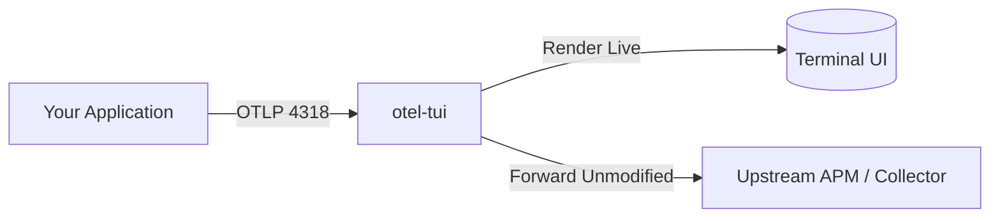

# Relay Proxy & Port Fallback

`otel-tui` is engineered to fit seamlessly into existing developer environments without conflicting with running daemons, Docker containers, or upstream collectors.

---

## 1. Automatic Port Fallback

By default, `otel-tui` attempts to bind to the official standard OpenTelemetry receiver ports:
- **4317** (gRPC)
- **4318** (HTTP Protobuf & JSON)

If another service (such as Docker, an official OpenTelemetry Collector, or a local Jaeger container) already occupies these ports, `otel-tui` **will not crash**.

Instead, it gracefully falls back:
1. Detects `EADDRINUSE` on port 4317 or 4318.
2. Displays a clear notification in the status bar.
3. Automatically increments and binds to the next available free ports (e.g., `4319`, `4320`).
4. Prints the active listening endpoints directly in the startup banner.

### Specifying Custom Ports
You can explicitly override port bindings using CLI flags:

```bash
otel-tui --grpc-port 50051 --http-port 8088
```

---

## 2. Transparent Relay Mode (`--forward-to`)

In many development setups, you already send traces to an upstream APM backend, such as:
- A local Jaeger or Grafana Tempo instance
- An OpenTelemetry Collector gateway
- A cloud vendor (Datadog, Honeycomb, New Relic)

With `--forward-to`, `otel-tui` acts as a transparent **passthrough proxy**:



### Usage

```bash
# Forward all received traces to a local Jaeger collector on port 14318
otel-tui --forward-to http://localhost:14318

# Forward to an upstream OpenTelemetry Collector daemon
otel-tui --forward-to http://collector.internal.net:4318
```

### Key Advantages
- **Dual-Visibility**: Inspect requests locally in real-time with microsecond latency without breaking your team's centralized tracing pipeline.
- **Non-Invasive**: No changes required in your application configuration.
- **Resilient**: If the upstream collector goes down or times out, `otel-tui` logs a non-blocking warning without losing local terminal visibility or interrupting the sending application.
