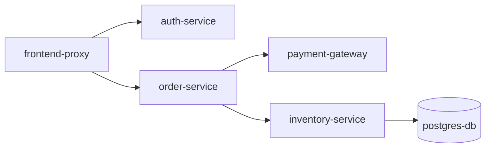

# Synthetic Event Generator

Don't have a live microservice stack running locally? Need to demo `otel-tui`, test edge cases, or explore performance regressions without configuring complex SDKs?

`otel-tui` includes a built-in **Synthetic Event Generator** that produces realistic, multi-service OpenTelemetry traces with errors, N+1 query patterns, and asynchronous fan-outs.

---

## 1. Quick Demo Mode (`--demo`)

Start `otel-tui` with the `--demo` flag to immediately populate the interface with realistic streaming traffic:

```bash
otel-tui --demo
```

The background generator continuously emits randomized, interconnected traces every 1–3 seconds, allowing you to explore the Waterfall, Flamegraph, Service Topology, and Inspector without running any external services.

---

## 2. On-Demand Injection in TUI (<kbd>D</kbd>)

When running `otel-tui` in normal mode, you can inject synthetic traces on demand:

- Press <kbd>D</kbd> anywhere in the TUI to instantly generate and ingest a diverse batch of synthetic traces.
- Great for testing layout resizing, filtering, or verifying detection algorithms on the fly.

---

## 3. Headless Stream Generator (`otel-tui demo --stream`)

You can also run the generator as a standalone CLI emitter to pump synthetic traffic into any running OTLP receiver (such as another `otel-tui` instance, OpenTelemetry Collector, Jaeger, or Datadog):

```bash
# Stream synthetic traces to the default local OTLP HTTP receiver (localhost:4318)
otel-tui demo --stream

# Stream to a custom endpoint at 5 traces per second
otel-tui demo --stream --endpoint http://localhost:4318 --rate 5

# Emit over gRPC (localhost:4317)
otel-tui demo --stream --endpoint localhost:4317 --protocol grpc
```

---

## Built-In Realistic Scenarios

The synthetic generator simulates complex microservice behavior rather than trivial single-span pings:

### 1. E-Commerce Checkout Flow

- Multi-tier RPC call hierarchy with distributed context propagation.
- Realistic timing distributions (auth token verification, order validation, card tokenization).

### 2. N+1 Query Regression Scenario
- Triggers an automated warning badge in the trace table (`N+1 DB Queries detected`).
- Simulates an endpoint executing an initial batch query followed by dozens of identical sequential database queries (e.g. `SELECT * FROM users` followed by 20 `SELECT * FROM orders WHERE user_id = ?`).

### 3. Downstream Timeout & Error Scenarios
- Randomly generates transient network timeouts and HTTP 504 / 500 error traces.
- Spans include full OTLP error status, `exception.type`, and stack traces for inspection in the [Span Inspector Drawer](../views/inspector.md).

### 4. Cache Hit vs. Miss Patterns
- Simulates rapid Redis cache lookups (~1ms) that occasionally miss and cascade down to slow relational queries (~80ms).
