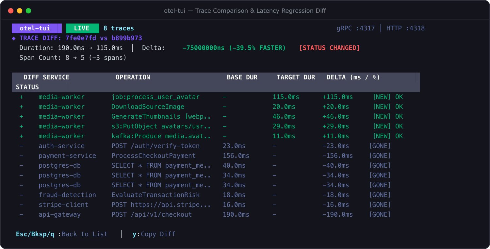

# Trace Comparison & Diffing

When optimizing code or investigating regressions, developers often need to answer:
> *"Why did this request take 650ms when the baseline run took 120ms?"*

`otel-tui` provides a built-in comparative trace diff engine accessible with **`m`** (mark) and **`d`** (diff).

---

## How to Compare Traces

1. In the main Trace List view, navigate to the trace you want to use as your benchmark.
2. Press **`m`** to mark it as the **baseline** (`[BASE]`).
3. Move the cursor to the regression or comparison trace.
4. Press **`d`** to launch the **Trace Diff View**.

*(If no trace is marked, pressing `d` compares the currently selected trace with the one immediately adjacent to it).*

---

## Diff Table Breakdown



```
◆ TRACE DIFF: a4d70688 vs 5e100935
  Duration: 120.0ms ➔ 650.0ms  │  Delta: +530.0ms (+441.7% SLOWER) [STATUS CHANGED]
  Span Count: 6 ➔ 8 (+2 spans)

  DIFF SERVICE            OPERATION                    BASE DUR     TARGET DUR   DELTA (ms / %)     STATUS
  ▲    payment-service    ProcessCheckoutPayment       60.0ms       580.0ms      +520.0ms  +866.7%  ERROR
  +    postgres-db        SELECT * FROM payment_m...   -            45.0ms       +45.0ms    [NEW]   OK
  +    postgres-db        SELECT * FROM payment_m...   -            45.0ms       +45.0ms    [NEW]   OK
       auth-service       POST /auth/verify            25.0ms       26.0ms       +1.0ms      +4.0%  OK
  -    redis-cache        GET session:user             5.0ms        -            -5.0ms     [GONE]  OK
```

### Visual Change Indicators:
- `▲` (Red): Span latency increased significantly or status degraded to `ERROR`.
- `▼` (Green): Span latency decreased or status improved.
- `+` (Green): New span present in the target trace that was absent in the baseline (e.g. extra database queries or fallback retries).
- `-` (Gray): Span present in the baseline but missing in the target trace (e.g. bypassed cache).
- `[STATUS CHANGED]`: Flags when a trace that was previously `OK` transitioned to `ERROR`.

Press **`Esc`**, **`Backspace`**, or **`q`** to return to the Trace List.
