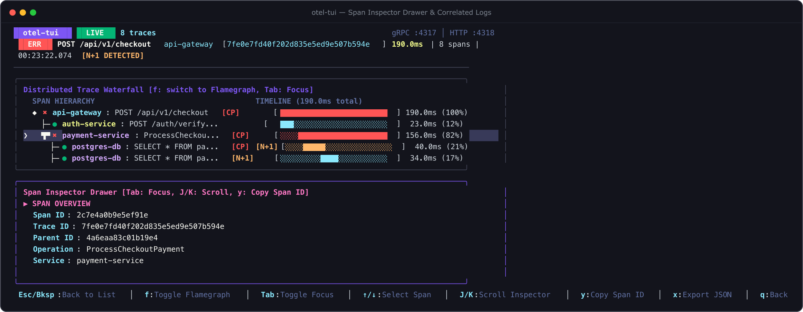

# Span Inspector Drawer

The **Span Inspector Drawer** gives you deep-dive visibility into every attribute, event, exception stack trace, and correlated log line attached to a span.

Press <kbd>Enter</kbd> or <kbd>i</kbd> on any highlighted span in the Waterfall or Flamegraph view to toggle the inspector drawer.



---

## Anatomy of the Inspector

```text
┌─ Span Inspector: GET /api/v1/checkout [orders-service] ──────────────────────────┐
│                                                                                 │
│ Trace ID:   4bf92f3577b34da6a3ce929d0e0e4736                                   │
│ Span ID:    00f067aa0ba902b7                                                    │
│ Parent ID:  5fb397be34d23b0f                                                    │
│ Status:     ERROR (HTTP 500 Internal Server Error)                              │
│ Duration:   45.2ms (Started 2026-10-22 14:32:01.120 UTC)                        │
│                                                                                 │
├─ Attributes ────────────────────────────────────────────────────────────────────┤
│  http.method:              POST                                                 │
│  http.route:               /api/v1/checkout                                     │
│  http.status_code:         500                                                  │
│  http.client_ip:           192.168.1.104                                        │
│  user.id:                  usr_998241                                           │
│  deployment.environment:   production                                           │
│                                                                                 │
├─ Events (1) ────────────────────────────────────────────────────────────────────┤
│  [+34.2ms] exception                                                            │
│    exception.type:    DatabaseConnectionTimeout                                 │
│    exception.message: Connection pool exhausted (max 50 connections)            │
│                                                                                 │
├─ Correlated Logs (2) ───────────────────────────────────────────────────────────┤
│  14:32:01.145 [WARN] Connection wait queue depth exceeded threshold (48/50)    │
│  14:32:01.154 [ERROR] Failed to obtain DB connection after 30000ms              │
│                                                                                 │
└─ Press [Esc] or [i] to close ───────────────────────────────────────────────────┘
```

---

## Sections

### 1. Metadata Header
- **Trace ID & Span ID**: Unique 128-bit trace and 64-bit span identifiers.
- **Parent ID**: The immediate parent span identifier, allowing you to trace hierarchy.
- **Status & Status Description**: `OK`, `ERROR`, or `UNSET`. Error spans highlight the root cause explanation if provided in OTLP status messages.
- **Timing & Wall Clock**: Precise start timestamp and microsecond-level duration.

### 2. Attributes Table
Displays all OpenTelemetry semantic conventions and user-defined tags attached to the span, including:
- HTTP attributes (`http.method`, `http.target`, `http.status_code`, `http.user_agent`)
- Database attributes (`db.system`, `db.name`, `db.statement`, `db.operation`)
- RPC / gRPC attributes (`rpc.system`, `rpc.service`, `rpc.method`, `rpc.grpc.status_code`)
- Custom business dimensions (`tenant.id`, `feature_flag.key`, `cart.items_count`)

### 3. Events & Timed Annotations
OpenTelemetry events mark discrete points in time within a span's lifetime.
- Displays relative offset (`+X.Xms`) from span start.
- Full event attributes (e.g. exception details, GC pauses, cache misses).

### 4. Exceptions & Stack Traces
When a span records an exception:
- Highlights `exception.type`, `exception.message`, and the full uncropped `exception.stacktrace`.
- Enables rapid root-cause diagnosis without needing to search external APM logs.

### 5. Correlated Logs
If your service emits OTLP log records that carry matching `trace_id` and `span_id`, `otel-tui` correlates and lists them chronologically alongside the span.

---

## Keyboard Controls

| Key | Action |
|:---:|:---|
| <kbd>Enter</kbd> / <kbd>i</kbd> | Open or close the Inspector Drawer |
| <kbd>j</kbd> / <kbd>↓</kbd> | Scroll down inside the drawer |
| <kbd>k</kbd> / <kbd>↑</kbd> | Scroll up inside the drawer |
| <kbd>y</kbd> | Copy selected Span ID / Trace ID to system clipboard |
| <kbd>Esc</kbd> | Close drawer and return focus to Waterfall / Flamegraph |
